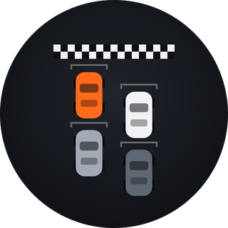
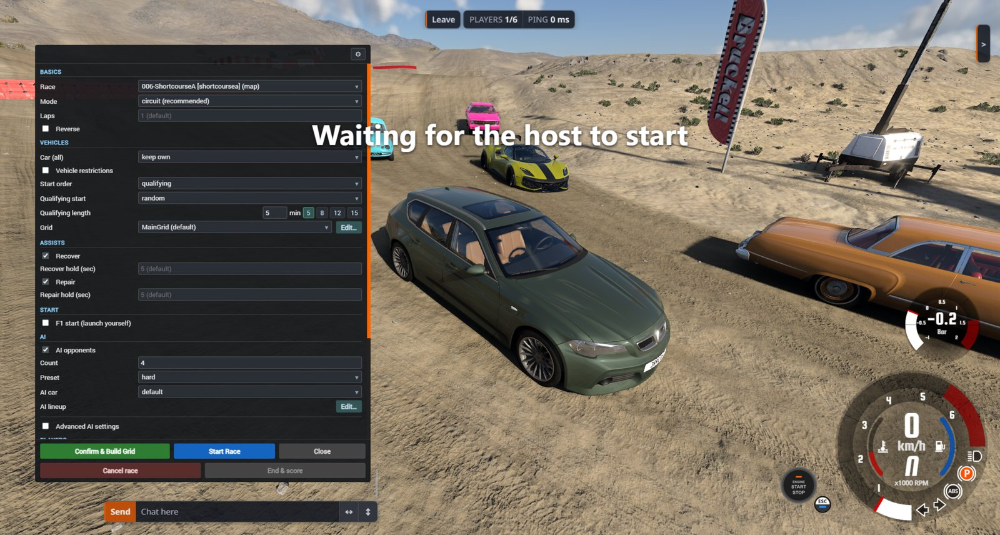

<h1 align="center">BeamComp</h1>

<p align="center">
  
</p>

**Turn BeamNG.drive's singleplayer time-trial races into real multiplayer races on your BeamMP
server.**

BeamNG ships hundreds of time-trial races, and every one of them is a solo affair against the clock.
BeamComp takes those same races and runs them for everyone on the server at once. An admin picks a
race, every player spawns on a starting grid with fresh cars and the track's own props and cones, and a
countdown holds the field. From the green light on you are racing each other, with checkpoints, live
position, and a standings board that updates while you drive.

Built for small groups on private servers who would rather race than free-roam.

This is an Early Access release: complete and playable, with a few known rough edges listed in
[CHANGELOG.md](CHANGELOG.md).

BeamComp is free and open source. If you enjoy it, you can support it on
[Patreon](https://www.patreon.com/c/ReneKnap), [Buy Me a Coffee](https://buymeacoffee.com/rekn) or
[PayPal](https://paypal.me/ReneKnap). That is voluntary and buys nothing extra.

## What you get



- **Real starting grids.** Cars line up in rows and columns, not in a heap on the spawn point. Grids
  are editable in-game and saved per race.
- **A synchronized start.** A countdown that locks every car, or an F1-style light sequence where the
  car is free and a jump start costs you time instead.
- **Live race information.** Next checkpoint, your position, your time, and the standings of everyone
  on track.
- **Qualifying**, if you want a grid order that was earned rather than drawn.
- **Championships and class-drop tournaments** across several races in one session.
- **AI opponents.** Up to 16, with difficulty presets, so a group of three still gets a full field.
- **Vehicle rules.** Everyone in the same car, everyone in a random car, or free choice within a power
  and weight limit.
- **In-race assists.** Recover and repair on a held key, on by default and switchable per race.

## Requirements

| | |
|---|---|
| Game | BeamNG.drive with the BeamMP client mod installed |
| Server | A BeamMP server you can put files on |
| Tested against | BeamNG.drive 0.40 |

## The three commands

**If you are just playing, there is nothing to install.** BeamMP hands you the client mod when you
join a server that runs BeamComp, and the race HUD appears on its own when a race starts. Everything
else happens in BeamComp's windows, and these three commands open them. When you join, BeamComp lists
the ones you can use in the chat.

`/raceui` opens the race panel. There you pick a race and set everything up: laps, direction, grid,
vehicle rules, AI, qualifying and the start mode, with an explanation on every field. On a server with
a password, this is also where you enter it.

`/keys` opens a window showing which keys your game has for repairing your car and for getting back to
the last checkpoint, on every device you have connected. Hold one of them while standing still. Click a
key in the window to bind a different one, or remove it.

`/name` sets the name everyone sees in the standings and the results, for example `/name Alex`.
Without it you race under your BeamMP name. It is worth it if you join as a guest, because a guest name
changes every time you start the game. Two to twenty characters, spaces allowed.

**Reset UI layout** in the gear menu of the `/keys` window and of the race panel puts every BeamComp
window back to the size and position it ships with. Once you move or resize a window, it keeps that
geometry for good, so this button is also how a size changed in an update reaches you.

Every chat command, including the ones for typing a whole race setup into the chat, is listed in
[COMMANDS.md](COMMANDS.md).

## If you run the server

### 1. Install

The download unpacks to five things:

```
README.md       this file
COMMANDS.md     every chat command
CHANGELOG.md    what is in this version, and what is known to be rough
LICENSE         the terms it comes under
Resources/      the mod itself
```

Copy `Resources` into your BeamMP server folder, merging it with the one already there. Afterwards
your server has:

```
<BeamMP-Server>/Resources/Client/BeamComp.zip     the mod players receive
<BeamMP-Server>/Resources/Server/BeamComp/        the plugin the server runs
```

Then restart the server. It prints `beamcomp` lines on startup; if you see none, the plugin did not
load.

You do not need to hand `BeamComp.zip` to anyone. BeamMP delivers it to every player who joins.

### 2. Raise `MaxCars`

**Skip this and most AI cars never appear.** BeamMP's `MaxCars`, in your server's `ServerConfig.toml`,
caps how many vehicles a single player may have synced. A race spawns all of its vehicles under the
race host: their own car, the track's prop and cone vehicles, and every AI car. If that adds up to more
than `MaxCars`, BeamMP silently deletes the rest, so only the first few AI ever appear.

Set it high enough for the worst case, for example **64**: one own car, about 40 props and 16 AI.

### 3. Decide who may start races

Starting and aborting races, saving and deleting grids and presets, and running the championship are
**admin-gated**. `Resources/Server/BeamComp/beamcomp.config.ini` offers two ways in, and they work side
by side:

```ini
# Any text you like.
racePassword = pick-something

# Race admins by BeamMP name, comma separated.
raceAdmins =
```

- **`racePassword`**: a player types `/raceui`, the race panel opens with a password box, and the right
  password makes them a race admin **until they leave the server**. Nothing is stored on the client, so
  it is entered once per session. Five wrong tries start a 60-second cooldown. Every attempt is logged
  with the player's name and never with what they typed.
- **`raceAdmins`**: a list of BeamMP names that are race admins without a password. A guest gets a new
  name every time they start the game, so list only players who log in to BeamMP.

> **With neither set, every connected player may start races, overwrite grids and run the
> championship.** That is the deliberate default so nothing breaks on an existing server, and the
> server prints a boxed warning at startup whenever it applies.

The settings file is read **once, at server start**. Change the password, then restart the server.

**Every setting is explained in the file itself.** Open it once and you have the whole picture. What
follows here is the same thing in short.

<details>
<summary>The rest of the settings file</summary>

`beamcomp.config.ini` is a plain `key = value` file, one setting per line:

```ini
# Lines starting with # are comments.
raceAdmins = Alice, Bob
racePassword = something-only-we-know
useClientName = true
showDriverNames = true
```

- `useClientName`: whether players may pick the name everyone sees with `/name`. `false` always uses
  the BeamMP name.
- `showDriverNames`: whether a driver's name is drawn over their car. `false` removes every nametag in
  the session. The race's props never carry one either way. An admin can also switch it in the race
  panel's gear menu, and that change is written back into this file.
- A line that cannot be read is **skipped with a warning naming its line number**, and every other
  setting still applies. A typo costs you that one line, not the password three lines below it.
- A `#` (or `;`) starts a comment **only at the start of a line**. Mid-line it is an ordinary character,
  so a password may contain one.
- The value is everything after the **first** `=`, trimmed at both ends. A password may contain `=`, but
  cannot begin or end with a space. There is no quoting.
- An empty value means "not set", for every key.

</details>

### Updating

Copy the new `Resources` over the old one like a fresh install, but keep your own copies of three files
in `Resources/Server/BeamComp/`:

```
beamcomp.config.ini      your password and settings
beamcomp.grids.json      your grids
beamcomp.presets.json    your saved setups
```

Let the copy skip them, or put them back afterwards. Then restart the server.

## Running a race

Open the race panel with `/raceui`, pick a race and set it up. **Confirm & Build Grid** puts everyone on
the grid, and the field waits there until you press **Start Race**. Staging never ends by itself.

The panel checks the race and your settings before anything spawns, and tells you what is wrong instead
of starting something broken. While a race runs, **End & score** ends it and scores it as it stands, and
**Cancel race** throws it away and returns everyone to free roam. Setups can be saved under a name and
loaded again next time.

## Starting grids

**105 races come with a grid already built and assigned**, covering Grid Map, Hirochi Raceway, Italy
and West Coast USA. You do not have to do anything for those, they start on a proper grid out of the
box. Every other race starts on a sensible default layout until you build one for it.

**Edit…** next to the grid in the race panel opens the grid editor: rows and columns, spacing, where the
field sits relative to the start line, and how it is angled. You see the result on the track while you
edit it. Grids are saved by name, and one can be set as the default for a race, so it is used every
time that race is started.

Grids live in `Resources/Server/BeamComp/beamcomp.grids.json`. Keep that file when you update and your
own grids stay. Grids added in a later version then do not reach your server; the changelog says when
new ones ship.

## When something looks wrong

- **Only the first few AI cars appear.** `MaxCars` is too low, see step 2 above.
- **An update has no effect in-game.** BeamMP can keep running the old client mod from its cache.
  Restart BeamNG completely.
- **The password stopped working after an update.** The update replaced `beamcomp.config.ini`. Put your
  copy back, or set the password again, and restart the server.
- **Everyone can start races.** Neither `racePassword` nor `raceAdmins` is set. The startup warning says
  so too.

## License

BeamComp is open source under the [MIT License](LICENSE). You may use it, change it, share it and build
on it, for any purpose. Keep the copyright notice and the license text with every copy. It comes with no
warranty.

BeamNG's own races, props and maps are not part of BeamComp and keep their own license. BeamComp reads
them from your game install.

## Credits

BeamComp is by Rene Knap.
